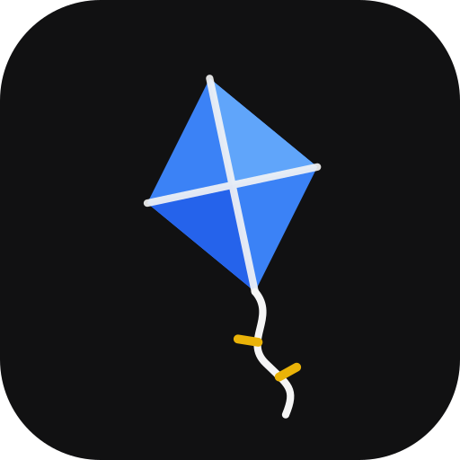
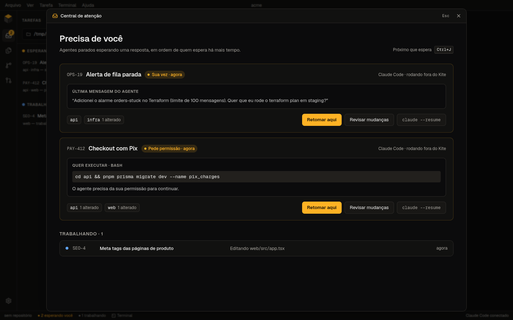
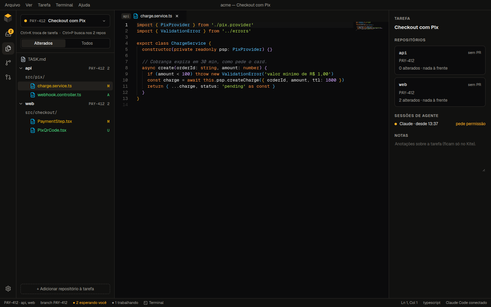
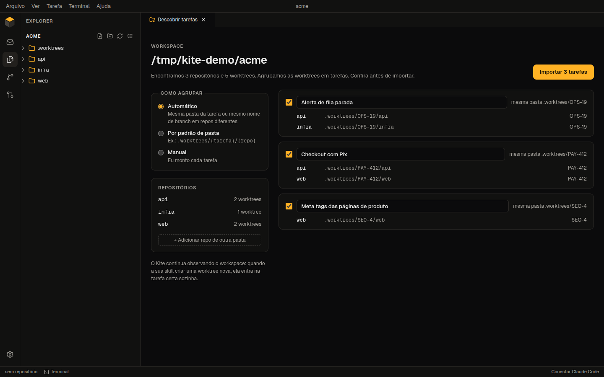
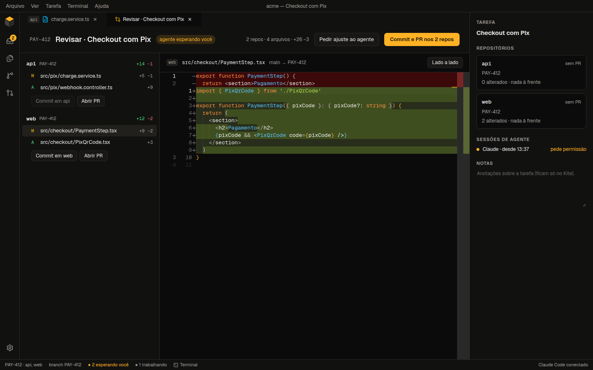
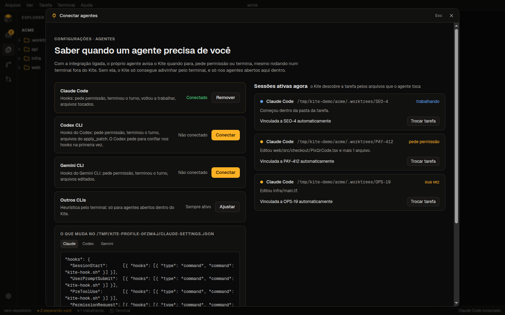
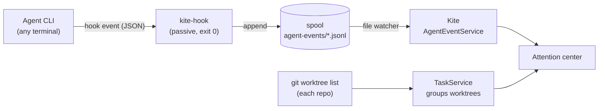

<div align="center">



# Kite

**A desktop IDE for working with AI coding agents.**
Know which agent is waiting for you, and work on tasks that span several repositories in one window.

[](LICENSE)


English · [Português](README.pt-BR.md)



</div>

## Why Kite

If you run several coding agents at once, one task each, you know the drill: a dozen terminals,
no idea which agent is stuck waiting for a "yes", and an editor window for every worktree of every
repository the task touches.

Kite is built around that workflow:

- **It watches the flow you already have.** Agents started in any terminal and worktrees created by
  your own scripts or skills show up on their own. You don't have to start anything from Kite.
- **It tells you who needs you.** Claude Code, Codex and Gemini CLI report through hooks when they
  ask for permission or finish a turn, so the attention center always knows who is waiting, and
  for how long.
- **A task is more than one repo.** Worktrees from different repositories are grouped into one
  task, which you open, edit, review and ship in a single window.

## Features

### Attention center

The sidebar groups every agent session into **Waiting for you**, **Working**, **To review** and
**No agent**, ordered by how long each one has been waiting. The attention center opens on top of
the editor (from the status bar, the menu or `Ctrl/Cmd+J`), and each card shows the command an
agent wants to run, or its last message. From there you can:

- jump to the agent's terminal;
- resume an external session inside Kite (`claude --resume`, `codex resume`, `gemini --resume`);
- open the task, or review its changes.

Press `Ctrl/Cmd+J` to go to the next agent that is waiting. Waiting agents also show up as a badge
and as a native notification.

### Multi-repo tasks



Open the folder that holds your repositories and Kite finds them, lists every worktree and groups
the worktrees into tasks. It groups worktrees that share a task folder (`.worktrees/PAY-412/{api,web}`)
or a branch name (ignoring prefixes such as `feat/`). You can also group them by a folder pattern,
or by hand: your adjustments always win over the heuristics.

- **Changed files first.** A task's explorer opens on the files that changed in each worktree
  against its base branch. "All" switches back to the full tree.
- **One window per task.** Quick open searches every repo in the task, tabs show which repo a
  file belongs to, and terminals open in the task folder.
- **Switch with `Ctrl/Cmd+K`.** Each task keeps its own tabs and terminals.
- **Card and notes.** A `TASK.md` or `.kite-task.json` in the task folder gives the task its title
  and card link. The details panel also has private notes.
- **No script? Use Kite.** "+ New" creates a worktree per repository following your folder
  pattern, then starts an agent in the task folder with an optional first prompt.

<p align="center">
  
</p>

### Review and ship



The review screen groups the changed files by repository, each diffed against its merge-base with
the base branch, including uncommitted work. From there:

- commit every repo with one message, push, and open one PR per repo. When a task has several
  PRs, each one links to the others in its description;
- send a follow-up to the agent ("Ask the agent for a change") straight into its prompt.

### Connect your agents



One click installs Kite's hooks for **Claude Code** (`~/.claude/settings.json`), **Codex**
(`~/.codex/hooks.json`) or **Gemini CLI** (`~/.gemini/settings.json`):

- Your existing hooks are preserved and the original file is backed up.
- You see a preview of the change before anything is written, and "Remove" undoes exactly what
  Kite added.
- The hook is passive: it never blocks or changes what the agent does.

Other CLIs (OpenCode, or any command you configure) still work, with status guessed from the
terminal output.

### And the IDE basics

- Monaco editor with tabs and a fuzzy quick open.
- Real terminals (PTY) with splits, search, and scrollback restored when you reopen the app.
- Git: status in the file tree, stage and commit, side-by-side diffs, branches and worktrees.
- GitHub: Device Flow login, PRs and issues with check status, "Open in worktree" for a PR, and
  opening PRs.
- Six themes, from the default amber-on-graphite to light and paper ones, applied to the editor,
  the terminals and native dialogs.
- A settings page (`Ctrl/Cmd+,`) for the theme, font sizes, terminal restore, notifications, task
  grouping and the GitHub account.

> [!NOTE]
> The interface is currently in Portuguese (pt-BR). Translations are welcome, see
> [Contributing](#contributing).

## Getting started

Kite is in early development and has no installers yet, so you run it from source.

**Requirements**

- Node.js 24+, and pnpm (`corepack enable pnpm`)
- Git 2.23+
- A build toolchain for `node-pty`:
  - Linux: `build-essential` and `python3`
  - macOS: Xcode Command Line Tools
  - Windows: Visual Studio Build Tools, with "Desktop development with C++"

**Run it**

```bash
git clone https://github.com/WesRamox/Kite-Agent-IDE.git
cd Kite-Agent-IDE
pnpm install   # also downloads Electron and rebuilds node-pty
pnpm dev
```

Then:

1. **Open the folder that holds your repositories** (File → Open folder). Pick the workspace,
   not a single worktree: Kite scans it two levels deep for repos and finds their worktrees
   wherever they live.
2. **Connect your agents** (status bar → "Conectar Claude Code"). This only affects sessions
   started after you connect.
3. Work as usual. Kite lists your sessions and tasks as they appear.

**GitHub login (optional).** Create an [OAuth App](https://github.com/settings/applications/new)
with **Enable Device Flow** checked, then put its client ID in a `.env` file:

```bash
cp .env.example .env   # set GITHUB_CLIENT_ID=...
```

No client secret is needed. The token is encrypted with the OS keychain (`safeStorage`) and is
never written in plain text.

The [detailed guide](docs/guide.pt-BR.md) covers every screen (in Portuguese).

## Keyboard shortcuts

| Shortcut                    | Action                                   |
| --------------------------- | ---------------------------------------- |
| `Ctrl/Cmd+J`                | Next agent waiting for you               |
| `Ctrl/Cmd+K`                | Switch task                              |
| `Ctrl/Cmd+P`                | Quick open (every repo of the open task) |
| ``Ctrl/Cmd+` ``             | Focus or open a terminal                 |
| ``Ctrl/Cmd+Shift+` ``       | New terminal                             |
| `Ctrl/Cmd+B`                | Show or hide the sidebar                 |
| `Ctrl/Cmd+S` / `Ctrl/Cmd+W` | Save / close tab                         |

When a terminal has focus on Linux and Windows, keys the shell needs go to the shell: use
`Ctrl+Shift+J` and `Ctrl+Shift+K` there.

## How it works



- **Hooks**: each event is appended to a local spool file. The hook runs with Electron's own
  binary (`ELECTRON_RUN_AS_NODE`), so Node doesn't need to be installed, and it exits in well
  under 100 ms. Kite reads the spool incrementally, so after a restart it rebuilds every session
  from disk.
- **Privacy**: only file paths and a short excerpt of the agent's last message are kept, locally.
  File contents are never stored or logged.
- **Security**: the renderer runs sandboxed with context isolation. It can only call named,
  zod-validated IPC functions, and file access is limited to the folders you opened.

**Built with** Electron, React, TypeScript (strict), Zustand, Tailwind CSS, Monaco, xterm.js,
node-pty, dockview, simple-git and Octokit, with Vitest and Playwright for tests.

## Status

Kite is **alpha**: it works day to day, but expect rough edges.

- Developed and tested on **Linux**. macOS and Windows builds are not verified yet: the hook
  command is a POSIX shell script, so Windows needs work.
- No packaged releases yet.

Design decisions are recorded in [`docs/decisions.md`](docs/decisions.md).

## Contributing

Issues and pull requests are welcome. [CONTRIBUTING.md](CONTRIBUTING.md) explains the project
structure, the scripts and the tests. Good places to start:

- English translation of the interface
- Windows support for the hooks
- Packaging and releases for macOS, Windows and Linux

## License

[MIT](LICENSE) © WesRamox
