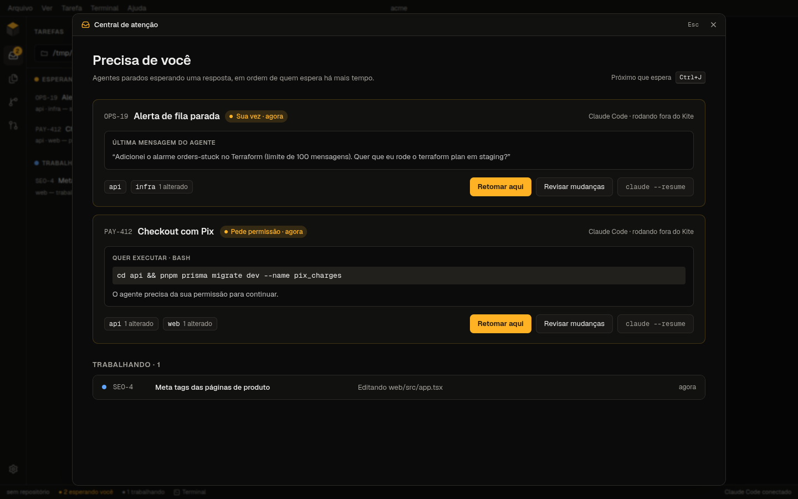
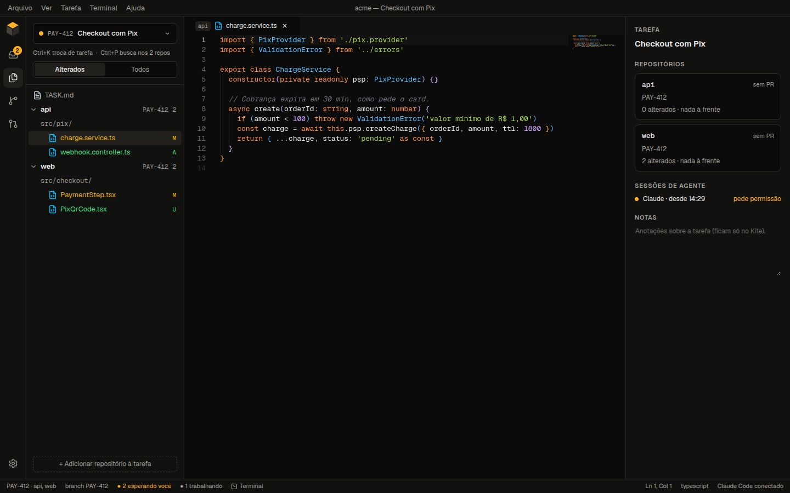
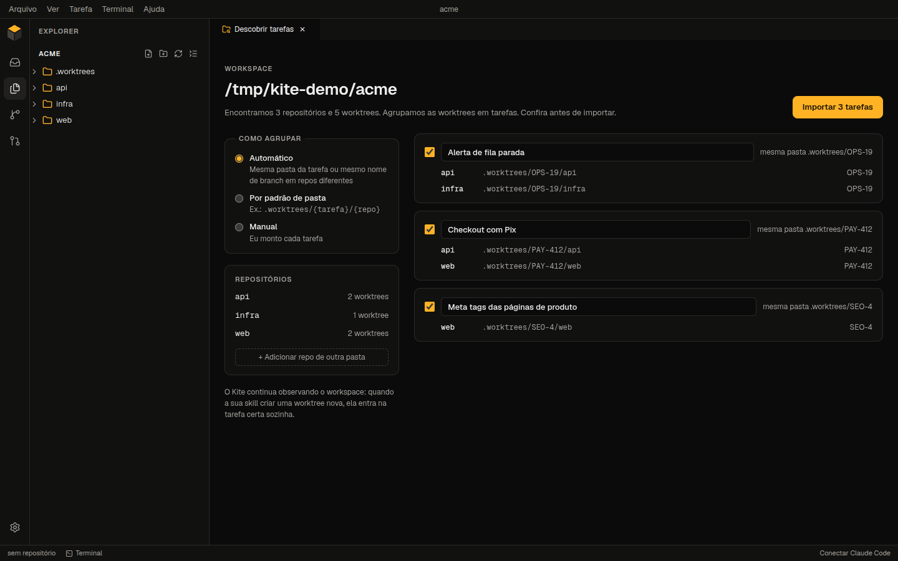
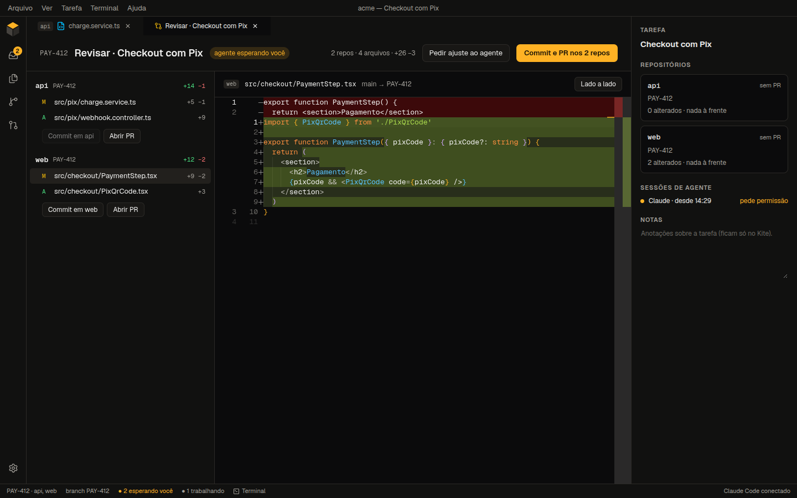
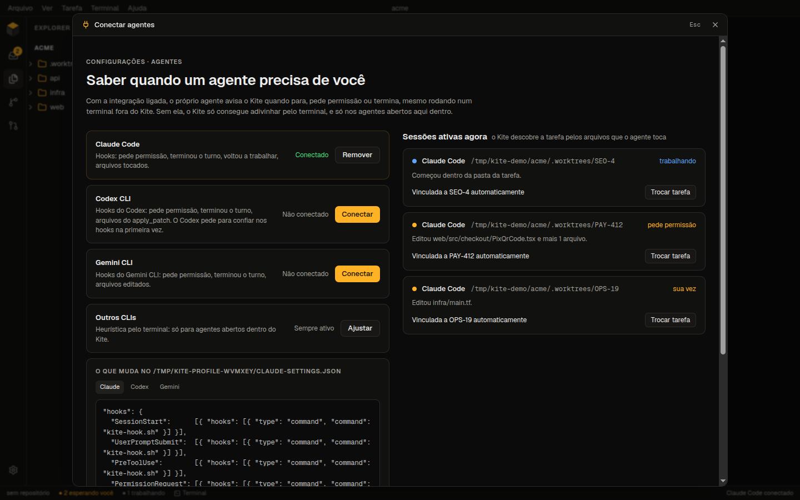
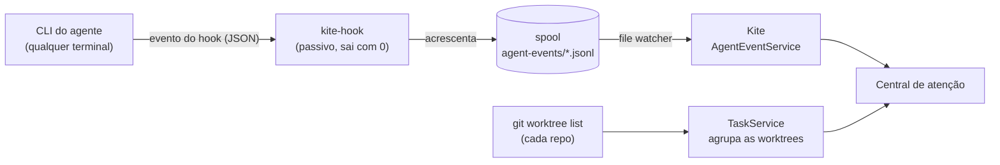

<div align="center">


# Kite

**Uma IDE desktop para trabalhar com agentes de IA.**
Saiba qual agente está esperando você e trabalhe em tarefas que mexem em vários repositórios numa janela só.

[](LICENSE)


[English](README.md) · Português



</div>

## Por que o Kite

Quem roda vários agentes ao mesmo tempo, um por tarefa, conhece a rotina: uma dúzia de terminais,
nenhuma ideia de qual agente está parado esperando um "sim", e uma janela do editor para cada
worktree de cada repositório da tarefa.

O Kite foi feito em torno desse jeito de trabalhar:

- **Ele observa o fluxo que você já tem.** Agentes abertos em qualquer terminal e worktrees
  criadas pelos seus scripts ou skills aparecem sozinhos. Nada precisa ser iniciado pelo Kite.
- **Ele avisa quem precisa de você.** Claude Code, Codex e Gemini CLI avisam por hooks quando
  pedem permissão ou terminam um turno, então a Central sabe sempre quem está esperando, e há
  quanto tempo.
- **Uma tarefa é mais que um repo.** Worktrees de repositórios diferentes viram uma tarefa só,
  que você abre, edita, revisa e entrega numa única janela.

## Recursos

### Central de atenção

A sidebar agrupa as sessões de agente em **Esperando você**, **Trabalhando**, **Para revisar** e
**Sem agente**, em ordem de quem espera há mais tempo. A Central abre por cima do editor (pela status
bar, pelo menu ou com `Ctrl/Cmd+J`), e cada card mostra o comando que o agente quer rodar, ou a
última mensagem dele. Dali você pode:

- ir até o terminal do agente;
- retomar uma sessão externa dentro do Kite (`claude --resume`, `codex resume`, `gemini --resume`);
- abrir a tarefa, ou revisar as mudanças dela.

`Ctrl/Cmd+J` leva ao próximo agente que espera. Agentes esperando também aparecem num badge e numa
notificação nativa.

### Tarefas multi-repo



Abra a pasta que reúne os seus repositórios e o Kite encontra cada um, lista as worktrees e agrupa
as worktrees em tarefas. Ele junta worktrees na mesma pasta de tarefa (`.worktrees/PAY-412/{api,web}`)
ou com o mesmo nome de branch (ignorando prefixos como `feat/`). Também dá para agrupar por um
padrão de pasta, ou à mão: os seus ajustes sempre vencem as heurísticas.

- **Primeiro, o que mudou.** O explorer da tarefa abre só com os arquivos alterados em cada
  worktree contra a branch base. "Todos" volta para a árvore completa.
- **Uma janela por tarefa.** O quick open busca em todos os repos da tarefa, as abas mostram o
  repo de cada arquivo e os terminais abrem na pasta da tarefa.
- **Troque com `Ctrl/Cmd+K`.** Cada tarefa guarda as próprias abas e terminais.
- **Card e notas.** Um `TASK.md` ou `.kite-task.json` na pasta da tarefa dá o título e o link do
  card. O painel de detalhes também tem notas, que ficam só no Kite.
- **Não tem script? Use o Kite.** "+ Nova" cria uma worktree por repositório seguindo o seu padrão
  de pasta e inicia um agente na pasta da tarefa, com um prompt inicial opcional.

<p align="center">
  
</p>

### Revisar e entregar



A revisão agrupa os arquivos alterados por repositório, cada um comparado com o merge-base da
branch base, incluindo o que ainda não foi commitado. Dali:

- commite todos os repos com uma mensagem só, envie e abra um PR por repo. Quando a tarefa tem
  vários PRs, cada um traz os links dos outros na descrição;
- mande um ajuste direto para o prompt do agente ("Pedir ajuste ao agente").

### Conectar os agentes



Um clique instala os hooks do Kite no **Claude Code** (`~/.claude/settings.json`), no **Codex**
(`~/.codex/hooks.json`) ou no **Gemini CLI** (`~/.gemini/settings.json`):

- Os seus hooks atuais são mantidos e o arquivo original ganha um backup.
- Você vê uma prévia da mudança antes de qualquer gravação, e "Remover" desfaz exatamente o que o
  Kite adicionou.
- O hook é passivo: nunca bloqueia nem muda o que o agente faz.

Outros CLIs (OpenCode, ou qualquer comando que você configurar) também funcionam, com o status
deduzido pela saída do terminal.

### E o básico de uma IDE

- Editor Monaco com abas e quick open com busca fuzzy.
- Terminais reais (PTY) com splits, busca e histórico restaurado ao reabrir o app.
- Git: status na árvore de arquivos, stage e commit, diff lado a lado, branches e worktrees.
- GitHub: login por Device Flow, PRs e issues com o status dos checks, "Abrir em worktree" a partir
  de um PR e criação de PRs.
- Seis temas, do padrão âmbar sobre grafite aos claros, aplicados ao editor, aos terminais e aos
  diálogos nativos.
- Página de configurações (`Ctrl/Cmd+,`): tema, idioma, tamanho das fontes, restaurar terminais,
  notificações, agrupamento das tarefas e conta do GitHub.
- Interface em português e em inglês: segue o idioma do sistema e pode ser trocada nas
  configurações. Outros idiomas são bem-vindos, veja [Contribuir](#contribuir).

## Como começar

O Kite está no começo do desenvolvimento e ainda não tem instaladores, então ele roda a partir do
código-fonte.

**Requisitos**

- Node.js 24+ e pnpm (`corepack enable pnpm`)
- Git 2.23+
- Ferramentas de compilação para o `node-pty`:
  - Linux: `build-essential` e `python3`
  - macOS: Xcode Command Line Tools
  - Windows: Visual Studio Build Tools, com "Desktop development with C++"

**Rodar**

```bash
git clone https://github.com/WesRamox/Kite-Agent-IDE.git
cd Kite-Agent-IDE
pnpm install   # também baixa o Electron e recompila o node-pty
pnpm dev
```

Depois:

1. **Abra a pasta que reúne os seus repositórios** (Arquivo → Abrir pasta). Escolha o workspace,
   não uma worktree solta: o Kite procura repos até dois níveis abaixo e encontra as worktrees
   deles onde quer que estejam.
2. **Conecte os agentes** (status bar → "Conectar Claude Code"). Vale para as sessões abertas
   depois de conectar.
3. Trabalhe como sempre. O Kite lista as sessões e as tarefas conforme elas aparecem.

**Login no GitHub (opcional).** Crie um [OAuth App](https://github.com/settings/applications/new)
com **Enable Device Flow** marcado e coloque o Client ID num arquivo `.env`:

```bash
cp .env.example .env   # preencha GITHUB_CLIENT_ID=...
```

Não precisa de client secret. O token é criptografado com o cofre do sistema (`safeStorage`) e
nunca é gravado em texto puro.

O [guia detalhado](docs/guide.pt-BR.md) explica cada tela.

## Atalhos

| Atalho                      | Ação                                            |
| --------------------------- | ----------------------------------------------- |
| `Ctrl/Cmd+J`                | Próximo agente esperando você                   |
| `Ctrl/Cmd+K`                | Trocar de tarefa                                |
| `Ctrl/Cmd+P`                | Quick open (em todos os repos da tarefa aberta) |
| ``Ctrl/Cmd+` ``             | Focar ou abrir um terminal                      |
| ``Ctrl/Cmd+Shift+` ``       | Novo terminal                                   |
| `Ctrl/Cmd+B`                | Mostrar ou ocultar a barra lateral              |
| `Ctrl/Cmd+S` / `Ctrl/Cmd+W` | Salvar / fechar aba                             |

Com o foco num terminal, no Linux e no Windows, as teclas de que o shell precisa vão para o shell:
lá, use `Ctrl+Shift+J` e `Ctrl+Shift+K`.

## Como funciona



- **Hooks**: cada evento é acrescentado a um arquivo local (o spool). O hook roda com o próprio
  binário do Electron (`ELECTRON_RUN_AS_NODE`), então não precisa de Node instalado, e termina em
  bem menos de 100 ms. O Kite lê o spool aos poucos, então ao reabrir reconstrói todas as sessões a
  partir do disco.
- **Privacidade**: ficam só caminhos de arquivo e um trecho curto da última mensagem do agente, e
  só na sua máquina. O conteúdo dos arquivos nunca é guardado nem logado.
- **Segurança**: o renderer roda em sandbox, com context isolation. Ele só chama funções IPC
  nomeadas e validadas com zod, e o acesso a arquivos fica restrito às pastas que você abriu.

**Feito com** Electron, React, TypeScript (strict), Zustand, Tailwind CSS, Monaco, xterm.js,
node-pty, dockview, simple-git e Octokit, com Vitest e Playwright nos testes.

## Situação

O Kite está em **alpha**: dá para usar no dia a dia, mas espere arestas.

- Desenvolvido e testado no **Linux**. macOS e Windows ainda não foram verificados: o comando do
  hook é um script de shell POSIX, então o Windows precisa de ajustes.
- Ainda não há versões empacotadas.

As decisões de projeto ficam em [`docs/decisions.md`](docs/decisions.md).

## Contribuir

Issues e pull requests são bem-vindos. O [CONTRIBUTING.md](CONTRIBUTING.md) explica a estrutura
do projeto, os scripts e os testes. Bons pontos de partida:

- Tradução para outros idiomas
- Suporte a Windows nos hooks
- Empacotamento e versões para macOS, Windows e Linux

## Licença

[MIT](LICENSE) © WesRamox
